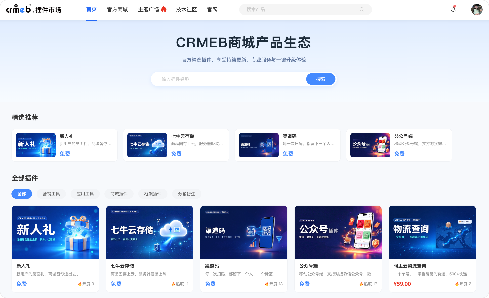

<div align="center">

# CRMEB High-Quality Open-Source Mall System v8 (PHP)

**Mid-platform Architecture · Modular Extensions · AI-Native · Multi-Terminal**

[中文说明](README_ZH.md)

</div>

<div align="center">
    <a href='https://gitee.com/ZhongBangKeJi/CRMEB/stargazers'>
       </img>
    </a>
    
    
</div>

<div align="center" style="font-size: 15px;">
  Built with care for open source — a Star 🌟 in the top-right corner means a lot to us.
</div>

---

### 📝 **Project Overview**

**Open Source Freedom**

CRMEB open-source mall is 100% open source under the **Apache-2.0** license, free for commercial use — truly “zero-cost” deployment and secondary development. A new mall foundation for the AI era.

**Mid-platform Architecture**

v8 is rebuilt as a mid-platform e-commerce architecture: the **Product Mid-platform** unifies multi-type products; the **Order Mid-platform** aggregates status and operations across order sources; the **After-sales & Refund Mid-platform** provides unified after-sales tickets and idempotent refunds. Product types (physical goods, cloud disk) and trade modes (normal, membership) are decoupled into two independent dimensions and can be freely combined via registries.

**Modular Plugin System**

Business capabilities are organized as pluggable **modules** (`modules/`) and **drivers** (`driver/`): currently 22 official modules (physical goods, cloud-disk products, H5 channel, WeChat Mini Program channel, check-in, AI Agent, MCP service, and more) and 30 official drivers (WeChat Pay, cloud storage, SMS, email, logistics tracking, e-waybill, e-invoice, product scraping, bots, cloud printing, and more). A fresh install defaults to 7 modules (1 required + 6 default) and 15 drivers. All support visual install / uninstall / enable / disable in the admin panel. Extensions follow a unified spec with zero-intrusion secondary development.

**AI-Native**

Built-in **AI Agent** module for admin AI chat, streaming responses, and automated tasks; **MCP service** exposes system tools to AI clients via `/api/mcp`, so humans and AI can operate the mall together. In the AI era, stability is the highest form of intelligence.

**Multi-Terminal**

One uni-app codebase covers **H5, WeChat Mini Program, and APP**. The admin panel is Vue 3 + Element Plus with front/back separation and real-time data sync for multi-channel operations.

---

### 📝 **CRMEB Ecosystem Marketplace**

**Ecosystem Plugins**

Browse the CRMEB marketplace for official curated plugins with continuous updates, professional support, and one-click upgrades — tailored to industry needs without deep technical skills.

**One-Click Import**

The system itself is plugin-based: product types, marketing campaigns, payments, logistics, distribution, content & community, analytics, third-party services, and industry customizations all plug in. Install what you need without touching core code or conflicting with upgrades. Import once and use immediately.

**Publish Plugins**

Use with ease — or earn with ease. Besides official plugins, developers can upload their own. Build industry-specific capabilities on the open-source AI foundation and list them on the marketplace. When others pay to download your work, you share the revenue — turning technical craft into income while growing the open-source mall ecosystem.

We are not building “just another storefront.” How far a system goes depends on how many people are willing to build on it. Missing a plugin? Tell the official team. Have a great plugin? Bring it and talk.

CRMEB Marketplace: <a href="https://www.crmeb.com/plugin" target="_blank">Plugin Market</a>




---

### 🧩 **Mid-platform Core Capabilities**

| Mid-platform | Description |
| --- | --- |
| **Product Mid-platform** | Product master data separated from type extensions; shared categories, SKUs, attributes, reviews, and stats across types. Modular product types with built-in physical goods and cloud-disk products; custom types supported |
| **Trade Mode Registry** | “How a product is sold” decoupled from “what a product is”: built-in normal purchase and membership trade modes handle promotional pricing, order validation, and lifecycle hooks; more playbooks register via the registry |
| **Order Mid-platform** | Multi-type orders unified with product snapshots and status logs; order-type adapters unify status trees, payment status, action buttons, and progress |
| **After-sales & Refund Mid-platform** | Unified after-sales applications and line items; product types declare available after-sales types and time windows via a rule registry; unified refund tickets + idempotent refund side-effect records; supports refund-only, return & refund, exchange, and repair |
| **User & Assets** | User-centric aggregation of addresses, tags, levels, membership, balance, points, commission, coupons, invoices, and referral relationships |

---

### 📦 **Modules & Drivers**

Currently 22 modules and 30 drivers. Fresh install defaults to 7 modules (1 required + 6 default) and 15 drivers. Manage them under Admin → Extension Management (physical goods is a protected base module and cannot be uninstalled).

**Built-in Modules**

| Module | Capability |
| --- | --- |
| Physical Goods | Common products & SKUs, logistics / delivery / pickup fulfillment (protected base module) |
| Cloud Disk Products | Digital goods, auto-delivered after payment |
| H5 Browser | H5 channel access and user auth |
| WeChat Mini Program | Mini Program channel access and user auth |
| Check-in | Consecutive / cumulative check-in rules, points rewards, records |
| AI Agent | Admin AI chat, streaming responses, automated tasks, and run records |
| MCP Service | `POST /api/mcp` exposes system tools to AI clients with independent key auth |

**Built-in Drivers**

| Category | Built-in Drivers |
| --- | --- |
| Payment | WeChat Pay, WeChat Pay V3 |
| Cloud Storage | Local storage, Alibaba Cloud OSS |
| SMS / Email | Yihaotong SMS, QQ Mail |
| Bots | WeCom bot, DingTalk bot, Feishu bot |
| Logistics & Fulfillment | Yihaotong tracking, e-waybill, e-invoice, product scraping |
| Cloud Print | Feie Cloud, Yilianyun |

---

### 🫧 **Technical Highlights**

~~~
Secondary development:
1. Coding standards: PSR-12 naming, RESTful APIs, strict Controller→Services→Dao→Model layering, complete comments, unified response body {status,msg,data};
2. Permission management: flexible RBAC — menus are permission rules down to each menu and action button;
3. Module scaffolding: php think make:module generates compliant skeletons (plugins, product types, drivers, trade modes, marketing observers);
4. Architecture guard: php think arch:check scans the three-layer dependency rule, cross-module imports, events, and comment conventions — CI-ready;
5. System events: dual event registries for core and modules; listeners attach at event anchors and load with module install state;
6. Scheduled tasks: dual timer systems for core and modules, auto-registered on module install;
7. API management: visual route management, import, and online debugging in admin;
8. Form engine: PHP form-builder on the backend, @form-create on the frontend;
9. Code generation: quickly generate admin menus, pages, and CRUD;
10. Docs: Chinese project docs under help/docs (overview, architecture, features, DB design, deploy, ops); admin can connect MCP knowledge services (doc/route/schema search);
11. AI development kit: .crmeb ships AI coding rules, skills, and sub-agents compatible with mainstream AI coding tools.
~~~
~~~
Performance & extensibility:
1. Security: JWT auth, role checks, operation logs, production logs, file integrity checks, data backup;
2. Performance: Redis cache, think-queue, Workerman long-connection gateway, multi cloud storage, cluster-ready;
3. i18n: admin and storefront multilanguage (vue-i18n) with browser language detection;
4. Driver extensions: ten categories — payment, upload, SMS, email, logistics, e-waybill, printing, bots, scraping, invoices — switch vendors freely for the same capability;
5. Realtime: unified WebSocket gateway (/ws) for admin realtime notifications and more;
6. Yihaotong: shared third-party extension for SMS, tracking, e-waybill, e-invoice, and product scraping.
~~~

---

### 📖 **Features**

<details>
<summary><b>Admin features (click to expand)</b></summary>

- **Workbench**: business metrics, order/user trends, sales rankings, pending reminders
- **Products**: product mid-platform, categories, multi-spec SKUs, attribute templates, reviews, scrape / import / export
- **Orders**: unified order mid-platform list & detail, ship / split ship, price & remark edits, tracking, invoices
- **After-sales & Refunds**: review, return receive, unified refund tickets, original-path refunds, idempotent side effects
- **Users**: groups, tags, levels, asset adjustments, account cancellation
- **Membership**: packages, benefits, paid membership
- **Marketing**: coupons, points, check-in campaigns
- **Page Builder**: DIY drag-and-drop storefront, one-click theme colors, bottom nav, splash ads, articles
- **Store & Delivery**: pickup, clerk verification, freight templates, e-waybill, cloud print
- **Finance**: fund flows, payment channel config, business stats
- **Notifications**: in-app, SMS, email, Official Account templates, Mini Program subscribe messages, bots
- **WeChat Ecosystem**: Official Account OAuth / menu / media / replies; Mini Program login / subscribe messages
- **Extensions**: install/uninstall/enable/disable modules & drivers; admin roles & permissions; config; timers; system logs & backup

</details>

<details>
<summary><b>Storefront features (click to expand)</b></summary>

- **Browse & Cart**: DIY home, category search, product detail, cart, combined checkout with coupons / points / balance
- **Orders & Pay**: multi-status order management, WeChat Pay / balance, tracking, reviews
- **After-sales**: dynamic after-sales forms, progress timeline, return logistics
- **Profile**: balance bills, points, coupons, membership benefits, addresses, message center
- **Engagement**: check-in for points, coupon claiming

</details>

---

### 🔐 **Runtime Requirements**

| **Runtime** | **Requirement** |
|------------------|--------------------------------------------------------------------------|
| **OS** | Linux / Windows |
| **Web Server** | Nginx / Apache / IIS |
| **PHP** | PHP 8.2 ~ 8.4 (default 8.4) |
| **Database** | MySQL 8.0 (engine: InnoDB, charset: utf8mb4, table prefix: `eb_`) |
| **Cache** | Redis (required in production; message queue depends on it) |
| **Process Manager** | Supervisor (for queue and other daemons) |
| **Node.js** | >= 18 (frontend builds only) |
| **PHP Extensions** | bcmath, curl, mbstring, json, zip, simplexml, fileinfo (optional), redis (optional) |
| **Disabled Functions to Enable** | `proc_open`, `pcntl_signal`, `pcntl_signal_dispatch`, `pcntl_fork`, `pcntl_wait`, `pcntl_alarm` (Workerman & queue) |
| **Queue** | `php think queue:listen --queue` (guard with Supervisor) |
| **Timer** | `php think timer start --d` (CLI) |
| **Long Connection** | `php think workerman start --d` (CLI, default port 40001) |

---

### 📺 **Dev Environment & Stack**

### **Development Environment**

| Tool | Version | Download |
|--------------|--------------------|--------------------------------------------------------------------------|
| **PHP** | 8.2 ~ 8.4 (default 8.4) | [PHP Downloads](https://www.php.net/downloads.php) |
| **Composer** | 2.x | [Composer](https://getcomposer.org/) |
| **MySQL** | 8.0 | [MySQL](https://www.mysql.com/) |
| **Redis** | 6.0+ | [Redis](https://redis.io/download) |
| **Nginx** | 1.22+ | [Nginx](http://nginx.org/en/download.html) |
| **Node.js** | 18 / 20+ | [Node.js LTS](https://nodejs.org/en/download/releases/) |

### Backend Stack

| **Tech** | **Description** | **URL** |
|---------------------|-----------------------------------------------------------------------------|--------------------------------------------------------------------------|
| ThinkPHP 8 | Core framework, multi-app (`adminapi` / `api` / `outapi`) | https://www.thinkphp.cn/ |
| think-queue | Message queue (Redis driver) | https://github.com/top-think/think-queue |
| workerman | High-performance socket service; long-connection gateway & timers | https://www.workerman.net |
| easywechat 6 | WeChat ecosystem (Official Account / Mini Program / Pay) | https://github.com/w7corp/easywechat |
| php-jwt | JWT generate & verify | https://github.com/firebase/php-jwt |
| form-builder | PHP form builder | https://form-create.com |
| phpspreadsheet | Excel import / export | https://github.com/PHPOffice/PhpSpreadsheet |
| guzzlehttp | HTTP client | https://guzzle-cn.readthedocs.io/zh-cn/latest |
| alipaysdk | Alipay SDK | https://github.com/alipay/alipay-easysdk |
| snowflake | Distributed unique IDs | https://github.com/godruoyi/php-snowflake |
| aliyun-oss / qiniu | Cloud storage SDKs | https://github.com/aliyun/aliyun-oss-php-sdk |

### Admin Frontend Stack

| **Tech** | **Description** | **Site** |
| --- | --- | --- |
| vue 3.5 | Vue framework | https://vuejs.org/ |
| element-plus 2.9 | UI framework | https://element-plus.org/ |
| pinia 2 | State management | https://pinia.vuejs.org/ |
| vue-router 4 | Routing | https://router.vuejs.org/ |
| vite 5 | Build tool | https://vitejs.dev/ |
| vxe-table 4 | Advanced table | https://vxetable.cn/ |
| echarts 5 | Charts | https://echarts.apache.org/ |
| wangeditor 5 | Rich text editor | https://www.wangeditor.com/ |
| monaco-editor | Code editor | https://microsoft.github.io/monaco-editor/ |
| axios | HTTP client | https://axios-http.com/ |
| vue-i18n 9 | i18n | https://vue-i18n.intlify.dev/ |
| form-create | Dynamic forms | https://form-create.com |
| xlsx / exceljs | Excel libraries | https://sheetjs.com/ |
| sass | CSS preprocessor | https://sass-lang.com/ |

### Mobile Stack

| **Tech** | **Description** | **Site** |
| --- | --- | --- |
| uni-app (official CLI + Vite 5) | Cross-end: one codebase → H5 / WeChat Mini Program / Alipay Mini Program / APP | https://uniapp.dcloud.net.cn/ |
| vue 3 | Vue framework | https://vuejs.org/ |
| pinia | State management | https://pinia.vuejs.org/ |
| vue-i18n | i18n | https://vue-i18n.intlify.dev/ |
| sass | CSS preprocessor | https://sass-lang.com/ |

---

### 🚀 **Quick Start**

---


### 📱 Demo

Admin: http://v8.crmeb.net/admin

Account: `demo` / Password: `crmeb.com`

H5: http://v8.crmeb.net/ (open on mobile)


Themes: https://www.crmeb.com/theme (desktop)

Plugins: https://www.crmeb.com/plugin (desktop)


---


**Host environment (recommended)**

```bash
# 1. Backend
cd backend
composer install
php think run --host 127.0.0.1 --port 8011

# 2. Admin (dev server default port 1619; /adminapi proxies to 8011)
cd frontend/admin
npm ci
npm run dev

# 3. Mobile
cd frontend/uni-app
npm install
npm run dev:h5          # H5; WeChat Mini Program: npm run dev:mp-weixin
```

**Backend daemons**

```bash
cd backend
php think queue:listen --queue      # Message queue (Supervisor)
php think timer start --d           # Scheduled tasks
php think workerman start --d       # WebSocket long-connection gateway
```

**Docker Compose (optional)**

```bash
./run.sh start    # Start (Nginx 8011 / MySQL 33061 / Redis 63791 / WebSocket 40001)
./run.sh ps       # Status
./run.sh logs     # Logs
```

**Frontend one-liners (`run.sh`)**

```bash
./run.sh admin:dev    # Admin dev server (port 1619)
./run.sh admin:build  # Build admin and publish to backend/public/admin
./run.sh uni:dev      # Mobile H5 dev server
./run.sh uni:build    # Build mobile H5 and publish to backend/public
```

> Default URLs: `http://localhost:8011`, admin at `http://localhost:8011/admin`.
> DB and other settings follow `backend/.env`. Full deploy guide: [部署指南](help/docs/部署指南.md).

---

### 📖 **Documentation**

Full Chinese docs ship under `help/docs/`:

| Doc | Content |
| --- | --- |
| [项目说明](help/docs/项目说明.md) | Positioning, roles, entry points, repo layout, quick start |
| [项目功能](help/docs/项目功能.md) | Full admin / storefront feature list and core flows |
| [项目架构](help/docs/项目架构.md) | Layered architecture, modules & drivers, registries |
| [模块与驱动](help/docs/模块与驱动.md) | Built-in modules and drivers |
| [数据库设计](help/docs/数据库设计.md) | Core table structures and relationships |
| [开发指南](help/docs/开发指南.md) | Local development, regression scripts, debugging |
| [部署指南](help/docs/部署指南.md) | Host and Docker deployment |
| [运维手册](help/docs/运维手册.md) | Day-to-day ops, backup/restore, troubleshooting |
| [安全与配置](help/docs/安全与配置.md) | Config reference and security baseline |
| [API Docs](help/docs/api/) | Admin / storefront API index |

🔗 <a href="https://gitee.com/xazbkj/crmebbz/issues" target="_blank">Feedback</a> | 📩 <a href="https://gitee.com/xazbkj/crmebbz/pulls" target="_blank">Contribute</a>

---

###  📞 **Community**

Bug reports and suggestions via Gitee Issues; contributions welcome via Pull Request.

---

❤️ Open source, commercially ready

Deeply upgraded from the CRMEB open-source edition, released under Apache-2.0.
