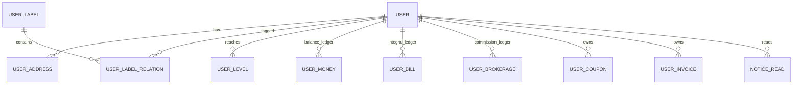
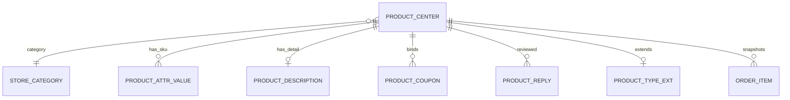
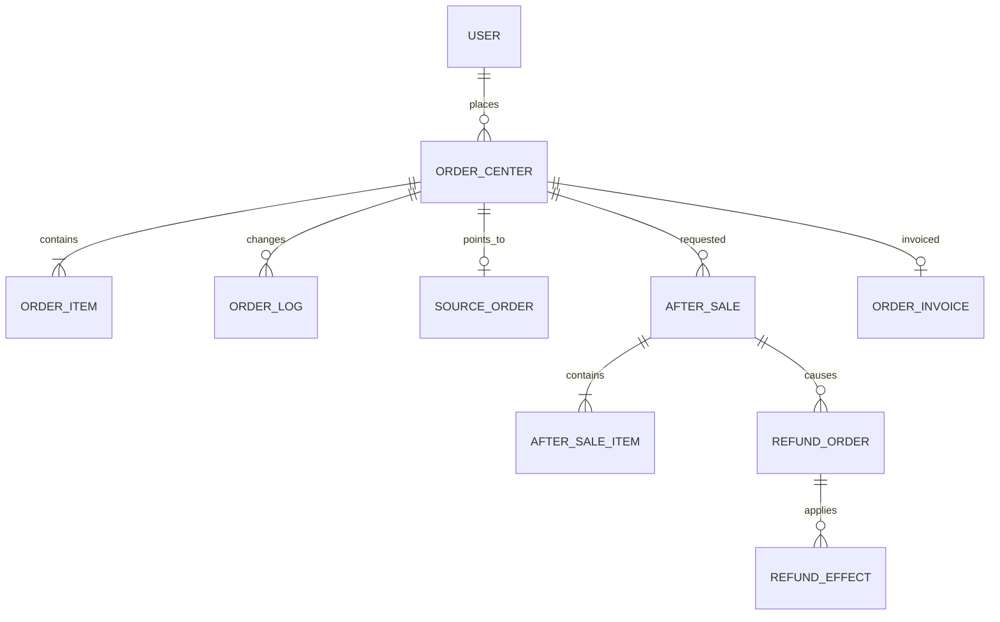
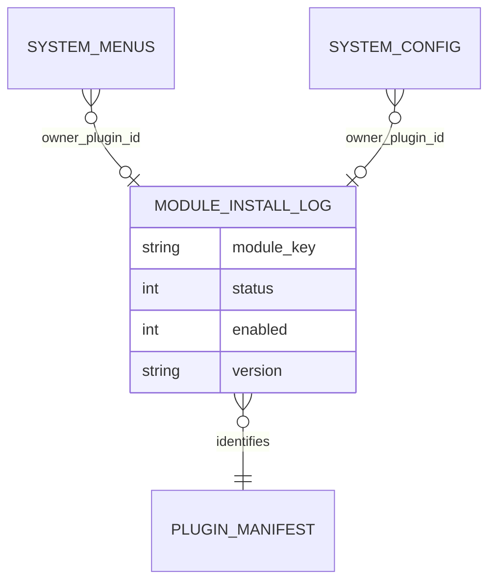

# 数据库设计文档

> 核对日期：2026-09-14。数量来自静态建表定义，不连接或修改实际数据库。

## 1. 总览

系统使用 MySQL 5.7+（推荐 8.0），默认数据库表前缀为 `eb_`，字符集为 `utf8mb4`。ThinkPHP 数据库配置位于 `backend/config/database.php`，支持通过环境变量覆盖连接和表前缀。

本项目的数据结构不是由单一文件完整定义，而来自三类来源：

| 来源 | 路径 | 用途 |
|---|---|---|
| 新装基础结构 | `backend/public/install/crmeb_table.sql` | 安装向导创建核心表，本次核对含 127 个 `CREATE TABLE` |
| 模块安装 | `backend/modules/**/Installer.php::runMigrate()` | 插件安装时创建产品、交易、营销、渠道等扩展表 |

运行库还可能包含 Installer 内联创建的扩展表。最终表数量取决于表前缀、已安装模块与实际安装历史，不能将 SQL 目录去重表名数当作运行库表数量。

## 2. 命名与字段约定

### 2.1 表名

- 默认使用 `eb_` 前缀，但代码必须通过配置或 Installer 的 `$this->table()` 适配自定义前缀。
- 核心表以业务名命名，例如 `eb_user`、`eb_order_center`。
- 产品类型扩展表使用 `eb_pt_{type}` 前缀，例如 `eb_pt_normal_order`。
- 模块表尽量带稳定业务前缀，避免与其他模块冲突。
- 历史表名可能保留拼写兼容，例如 `eb_page_categroy`，不能仅为纠正拼写直接重命名。

### 2.2 常见字段

不同表存在历史差异，但常见语义如下：

| 字段 | 常见含义 |
|---|---|
| `id` | 自增或业务主键 |
| `uid` | 用户 ID，关联 `eb_user.uid` 或用户主键语义 |
| `order_id` / `order_no` | 内部主键或可展示业务订单号，使用前先确认具体表 |
| `status` | 业务状态，枚举含义由具体领域定义 |
| `is_del` | 软删除标记 |
| `is_show` | 展示/启用状态之一，不应与 `status` 混用 |
| `add_time` / `create_time` | 创建时间，可能是 Unix 时间戳或 datetime |
| `update_time` | 更新时间 |
| `owner_plugin_id` | 共享资源所属插件，用于安全卸载 |

### 2.3 时间与金额

- ORM 配置开启自动时间戳，默认输出格式为 `Y-m-d H:i:s`。
- 历史表仍可能使用整型 Unix 时间戳，不能假设所有时间字段类型一致。
- 金额字段应使用数据库 `DECIMAL` 和字符串/高精度计算，不能用浮点数做财务比较。
- 金额变更应同时写业务单据和账单/流水，禁止只改用户汇总余额。

### 2.4 删除策略

- 业务主数据普遍使用 `is_del` 软删除。
- 订单、支付、退款、资金流水等审计数据不应物理删除。
- 模块卸载可能按 Installer 策略删除模块表，操作前必须备份。
- 共享表数据只能删除当前插件拥有的记录，依赖 `owner_plugin_id` 或明确归属条件。

## 3. 核心实体关系

### 3.1 用户与资产

关键原则：

- `eb_user` 是用户主记录。
- 用户余额、积分、佣金等汇总字段用于快速读取，对应账单表是审计和核对依据。
- 用户标签通过关系表实现多对多。
- 渠道身份由相应微信/渠道模块扩展，不应把所有 OAuth 字段持续堆入用户主表。

### 3.2 商品

商品由共享主表和产品类型扩展构成：

- `eb_product_center`：统一商品主表。
- `eb_store_product_attr_value`：通用 SKU/属性值。
- `eb_store_product_description`：商品详情。
- `eb_pt_normal`、`eb_pt_virtual` 等：产品类型业务字段。
- `eb_pt_*_sku`：产品类型专用 SKU/库存扩展。

商品删除或修改后，历史订单仍应从 `eb_order_item` 快照读取成交时信息。

### 3.3 订单与售后

核心关系：

- `eb_order_center` 统一汇总各种订单来源。
- `source_type` 与来源单号定位具体订单扩展表。
- `eb_order_item` 保存成交商品快照。
- `eb_order_log` 保存订单状态和操作记录。
- `eb_after_sale`/`eb_after_sale_item` 保存售后申请与明细。
- `eb_refund_order` 保存资金退款过程。
- `eb_refund_effect` 保存退款后本地副作用的幂等执行结果。

售后单号、退款单号和原订单号均应建立唯一或高选择性索引，以支持回调和排障。

### 3.4 模块安装

`eb_module_install_log` 是运行时模块白名单：`status=1 AND enabled=1`。菜单、配置等共享资源应记录所属插件，防止卸载时误删核心或其他插件记录。

## 4. 基础安装表目录

以下为 `backend/public/install/crmeb_table.sql` 中的基础表，按业务域归类。

### 4.1 用户、会员与资产

| 表 | 说明 |
|---|---|
| `eb_user` | 用户主表 |
| `eb_user_address` | 收货地址 |
| `eb_user_bill` | 用户账单/积分等记录 |
| `eb_user_money` | 用户余额账单 |
| `eb_user_brokerage` | 用户分佣账单 |
| `eb_user_brokerage_frozen` | 佣金冻结记录 |
| `eb_user_extract` | 用户提现 |
| `eb_user_recharge` | 用户充值记录 |
| `eb_user_level` | 用户等级记录 |
| `eb_system_user_level` | 用户等级配置 |
| `eb_user_member` | 用户会员关系 |
| `eb_member_ship` | 会员类型 |
| `eb_member_right` | 会员权益 |
| `eb_member_order` | 会员订单 |
| `eb_member_order_status` | 会员订单状态记录 |
| `eb_member_card_batch` | 会员卡批次 |
| `eb_member_card` | 会员卡 |
| `eb_agreement` | 会员/业务协议 |
| `eb_user_group` | 用户分组 |
| `eb_user_label` | 用户标签 |
| `eb_user_label_relation` | 用户标签关系 |
| `eb_category` | 通用标签分类 |
| `eb_user_friends` | 用户好友关系 |
| `eb_user_spread` | 用户推广关系 |
| `eb_user_enter` | 商户/入驻申请 |
| `eb_user_cancel` | 用户注销记录 |
| `eb_user_invoice` | 用户发票抬头 |
| `eb_user_search` | 搜索记录 |
| `eb_user_visit` | 用户访问记录 |

### 4.2 商品、分类与购物车

| 表 | 说明 |
|---|---|
| `eb_product_center` | 商品中台主表 |
| `eb_store_category` | 商品分类 |
| `eb_store_product_cate` | 商品分类辅助关系 |
| `eb_store_product_attr_value` | 商品属性/SKU 值 |
| `eb_store_product_description` | 商品详情 |
| `eb_store_product_rule` | 商品规格模板 |
| `eb_store_product_param` | 商品参数 |
| `eb_store_product_label` | 商品标签 |
| `eb_store_product_label_cate` | 商品标签分类 |
| `eb_store_product_protection` | 商品保障 |
| `eb_store_product_coupon` | 商品关联优惠券 |
| `eb_store_product_relation` | 商品收藏/点赞关系 |
| `eb_store_product_reply` | 商品评价 |
| `eb_store_product_log` | 商品统计日志 |
| `eb_store_visit` | 商品浏览分析 |
| `eb_cart` | 新中台购物车 |
| `eb_store_cart` | 历史/通用购物车兼容表 |

### 4.3 订单、售后与财务

| 表 | 说明 |
|---|---|
| `eb_order_center` | 统一订单中台 |
| `eb_order_item` | 订单商品快照 |
| `eb_order_log` | 订单状态日志 |
| `eb_order_economize` | 用户资金节省记录 |
| `eb_order_invoice` | 订单发票 |
| `eb_after_sale` | 售后单 |
| `eb_after_sale_item` | 售后商品明细 |
| `eb_refund_order` | 统一退款单 |
| `eb_refund_effect` | 退款副作用幂等日志 |
| `eb_offline_receipt` | 线下收银/其他订单 |
| `eb_offline_receipt_status` | 线下收银订单状态 |
| `eb_capital_flow` | 资金流水 |
| `eb_pay_channel` | 支付方式字典 |
| `eb_pay_channel_platform` | 支付方式与平台关系 |
| `eb_pay_record` | 原支付合同、后置任务及充值/取消补偿退款意图 |

`eb_pay_record` 已在首版安装结构中定义。支付与退款恢复先核对原业务单号、支付合同和副作用记录，排障及有写入风险的命令见 [运维手册](运维手册.md)。

### 4.4 优惠券

| 表 | 说明 |
|---|---|
| `eb_store_coupon_issue` | 前台领取活动/优惠券模板 |
| `eb_store_coupon_issue_user` | 用户领取记录 |
| `eb_store_coupon_product` | 优惠券适用商品关系 |
| `eb_store_coupon_user` | 用户优惠券发放/使用记录 |

### 4.5 物流、门店和打印

| 表 | 说明 |
|---|---|
| `eb_shipping_templates` | 运费模板 |
| `eb_shipping_templates_region` | 区域运费 |
| `eb_shipping_templates_free` | 指定包邮区域 |
| `eb_shipping_templates_no_delivery` | 不配送区域 |
| `eb_express` | 快递公司 |
| `eb_express_company` | 电子面单物流公司 |
| `eb_express_setting` | 电子面单业务设置 |
| `eb_express_template` | 电子面单模板 |
| `eb_express_dump_log` | 面单/打印记录 |
| `eb_system_store` | 门店自提点 |
| `eb_system_store_staff` | 门店店员/核销员 |
| `eb_delivery_service` | 配送人员 |
| `eb_system_ticket` | 小票打印机 |
| `eb_printer_channel` | 打印渠道 |
| `eb_printer_task` | 打印任务与执行记录 |

### 4.6 消息与渠道

| 表 | 说明 |
|---|---|
| `eb_notice` | 站内信 |
| `eb_notice_read` | 站内信已读记录 |
| `eb_notice_config` | 通知主配置 |
| `eb_notice_channel` | 消息渠道配置 |
| `eb_notice_template` | 通知与渠道/模板关联 |
| `eb_notice_log` | 消息发送日志 |
| `eb_sms_record` | 短信发送记录 |
| `eb_qrcode` | 微信二维码管理 |
| `eb_cache` | 微信等业务缓存表 |

### 4.7 内容、页面与主题

| 表 | 说明 |
|---|---|
| `eb_article` | 文章 |
| `eb_article_category` | 文章分类 |
| `eb_article_content` | 文章内容 |
| `eb_diy` | DIY 页面数据 |
| `eb_page_categroy` | 页面链接分类（历史拼写） |
| `eb_page_link` | 页面链接 |
| `eb_theme` | 主题 |
| `eb_theme_module` | 主题组件 |
| `eb_theme_download` | 主题下载记录 |

### 4.8 系统、配置与权限

| 表 | 说明 |
|---|---|
| `eb_system_admin` | 后台管理员 |
| `eb_system_role` | 角色/身份 |
| `eb_system_menus` | 菜单和接口权限规则 |
| `eb_system_log` | 管理员操作日志 |
| `eb_system_config_tab` | 配置分类 |
| `eb_system_config` | 系统配置（`type` 为控件类型 text/radio/textarea…，表单按其分发渲染；字段语义与种子写法见 crmeb-plugin-dev 技能「系统配置项种子」） |
| `eb_system_group` | 组合数据定义 |
| `eb_system_group_data` | 组合数据明细 |
| `eb_system_route_cate` | 路由分类 |
| `eb_system_route` | 路由规则 |
| `eb_system_crud` | CRUD 生成记录 |
| `eb_system_crud_data` | CRUD 数据字典 |
| `eb_system_crud_list` | CRUD 字典列表 |
| `eb_system_attachment_category` | 附件分类 |
| `eb_system_attachment` | 附件 |
| `eb_system_file_md5` | 文件校验数据 |
| `eb_system_pem` | 证书记录 |
| `eb_system_crontab` | 定时任务配置（原 `eb_system_timer`，已更名与代码命名对齐） |
| `eb_module_install_log` | 模块安装状态 |
| `eb_shared_table_registry` | 插件共享表资源登记 |
| `eb_upgrade_log` | 升级记录 |
| `eb_driver` | 统一驱动字典 |
| `eb_upload_storage` | 上传/云存储配置 |
| `eb_auxiliary` | 系统辅助数据 |
| `eb_ai_model` | AI 模型供应商与接口配置 |

### 4.9 国际化与区域

| 表 | 说明 |
|---|---|
| `eb_lang_type` | 语言类型 |
| `eb_lang_code` | 语言编码与文本 |
| `eb_lang_country` | 浏览器语言/国家类型 |
| `eb_system_city` | 城市/区域数据 |

## 5. 模块扩展表

以下表主要由模块 Installer 创建，运行库是否存在取决于模块状态和升级历史。

### 5.1 产品类型

| 模块 | 主要表 |
|---|---|
| 实物 | `eb_pt_normal`、`eb_pt_normal_sku`、`eb_pt_normal_order` |
| 网盘 | `eb_pt_virtual`、`eb_pt_virtual_sku`、`eb_pt_virtual_order` |
| 卡密 | `eb_pt_cardkey`、`eb_pt_cardkey_stock`、`eb_pt_cardkey_order` |

产品扩展表通常通过商品中台 ID 或具体订单号关联共享表。日期库存、卡密库存等高并发资源必须有唯一索引或条件更新策略。

### 5.2 交易模式

| 模块 | 主要表 |
|---|---|
| 砍价 | `eb_store_bargain`、`eb_store_bargain_user`、`eb_store_bargain_user_help` |
| 拼团 | `eb_store_combination`、`eb_store_pink` |
| 积分商城 | `eb_store_integral`、`eb_store_integral_order`、`eb_store_integral_order_status` |
| 秒杀 | `eb_store_activity`、`eb_store_seckill`、`eb_activity_seckill_sku`、`eb_store_seckill_time` |

### 5.3 分销代理

主要表包括：

- `eb_distribution_user`、`eb_distribution_relation`、`eb_distribution_relation_log`；
- `eb_distribution_level`、`eb_distribution_level_task`、`eb_distribution_level_task_record`；
- `eb_distribution_order`、`eb_distribution_brokerage`、`eb_distribution_brokerage_frozen`、`eb_distribution_extract`；
- `eb_distribution_admin_scope`；
- `eb_division_agent`、`eb_division_agent_apply`、`eb_spread_apply` 等兼容/扩展表。

分销订单表保存成交时推广链和佣金快照，后续用户关系变化不能修改历史快照。

### 5.4 渠道与营销

| 模块 | 主要表 |
|---|---|
| 微信公众号 | `eb_wechat_user`、`eb_wechat_message`、`eb_wechat_reply`、`eb_wechat_key`、`eb_wechat_media`、`eb_wechat_news_category` |
| 微信小程序 | `eb_routine_scheme`、`eb_live_anchor`、`eb_live_goods`、`eb_live_room`、`eb_live_room_goods` |
| App | `eb_app_version` |
| 渠道码 | `eb_wechat_qrcode`、`eb_wechat_qrcode_cate`、`eb_wechat_qrcode_record` |
| 抽奖 | `eb_luck_lottery`、`eb_luck_prize`、`eb_luck_lottery_record` |
| 签到 | `eb_system_sign_reward`、`eb_user_sign` |

### 5.5 服务与系统模块

| 模块 | 主要表 |
|---|---|
| 客服 | `eb_store_service`、`eb_store_service_log`、`eb_store_service_record`、`eb_store_service_speechcraft`、`eb_store_service_auto_reply`、`eb_store_service_feedback` |
| 开放平台 | `eb_out_account`、`eb_out_interface` |
| 文件管理 | `eb_system_file`、`eb_system_file_info` |
| AI Agent | `eb_ai_agent_conversation`、`eb_ai_agent_message`、`eb_ai_agent_task`、`eb_ai_agent_task_run`、`eb_ai_mcp_server` |

独立 MCP 服务主要维护系统配置、菜单与工具注册，不单独创建业务数据表；服务密钥不应以明文出现在文档和日志中。

## 6. 驱动相关表

新架构以 `eb_driver` 作为统一驱动字典，并由不同业务配置表保存启用状态和配置。升级目录中仍可见历史的 `eb_sms_driver`、`eb_email_driver`、`eb_express_driver`、`eb_invoice_driver`、`eb_bot_driver` 等建表/迁移文件。

首版新装使用统一驱动字典和真实驱动 Installer。生命周期身份是 `driver:类别:规范化key`，例如短信与物流的一号通是不同插件；字典、安装日志和具体服务配置需要分别核对。

只有明确维护历史数据库时才评估旧驱动表迁移；不能因文件或表名相似而直接删表，也不能把历史 SQL 全部执行一遍。

## 7. 索引与约束建议

### 7.1 必须唯一或近似唯一的业务键

- 用户手机号/渠道身份：按业务允许的唯一范围建立约束。
- 订单号、售后单号、退款单号、支付单号。
- 支付回调/退款回调的外部交易号。
- 模块 `module_key` 的有效安装记录。
- 产品类型 `source_type` 和订单来源标识。
- 卡密库存中的卡号或唯一资源标识。
- 按日期/场次等维度管理库存时的复合唯一键。
- 优惠券用户领取记录的业务唯一条件。

### 7.2 常用查询索引

- `uid + status + add_time`：用户订单、售后、优惠券和账单。
- `status + add_time`：后台待处理订单、退款、通知和队列补偿。
- `product_id + sku_id`：库存和商品明细。
- `order_no`/`source_type + source_id`：订单中台跳转来源单。
- `after_sale_no`、`refund_no`、`payment_no`：资金链路定位。
- `module_key + status + enabled`：模块状态加载。
- `owner_plugin_id`：插件卸载资源清理。

索引应根据真实慢查询和数据量验证，避免为所有状态字段单独建低选择性索引。

## 8. 事务与一致性

### 8.1 应放在同一事务的操作

- 订单主表、订单商品快照、订单日志和订单中台同步。
- 用户资产汇总与对应账单写入。
- 库存扣减与占用记录。
- 售后主表与售后商品明细。
- 分销订单快照与佣金账单。

外部支付、短信、对象存储等网络调用不应持有长数据库事务。可采用“本地状态提交 -> 外部调用 -> 回调/查询补偿”的方式。

### 8.2 幂等键

以下入口必须具备幂等性：

- 支付成功回调；
- 退款成功回调；
- 创建退款请求；
- 队列任务重试；
- 定时任务扫描；
- 对外推送重试；
- 模块安装和菜单写入。

推荐使用业务单号 + 动作类型作为唯一幂等键，或在事务中使用条件更新/唯一索引，不能只依赖进程内变量。

## 9. 分页与查询

数据库分页配置：

| 配置 | 值 |
|---|---:|
| 页码参数 | `page` |
| 每页参数 | `limit` |
| 默认每页 | 10 |
| 最大每页 | 100 |

API 列表通常返回 `list` 与 `count`。大数据导出不应提高 `limit` 绕过限制，应使用游标、分批读取或异步导出任务。

## 10. 新增/修改数据结构流程

### 10.1 核心表变更

1. 定义字段语义、默认值、空值策略、索引和回滚影响。
2. 确认当前处于首版开发阶段，核心改动直接纳入首次安装结构，不新增旧版本升级脚本。
3. 同步更新全新安装 SQL，确保新装结构一致。
4. 更新 Model/DAO/Services 和相关验证器。
5. 在隔离数据库验证新装与重复安装；若未来明确维护历史站点，再设计回填或增量迁移策略。
6. 验证大表 DDL 的锁表时间和生产执行窗口。
7. 更新本文档。

### 10.2 模块表变更

1. `Installer::runMigrate()` 保证首次安装得到最新结构。
2. 首版插件版本保持 `1.0.0`，结构、菜单、种子更新 Installer；首次与重复安装仍应幂等。未来已发布模块需要补列时，再提供针对性的增量路径。
3. `rollbackMigrate()` 明确卸载是删表、保留还是归档。
4. 所有表名使用配置前缀。
5. 安装、重复安装、禁用/启用和卸载分别验证，不能在不可恢复数据上做破坏性演练。

## 11. 备份与恢复

备份至少覆盖：

- MySQL 全量备份和二进制日志/PITR 策略；
- `backend/public/uploads` 或对应对象存储数据；
- 支付证书、私钥等受控密钥存储；
- 当前代码版本、`.version` 和部署配置；
- 插件清单及安装状态。

恢复演练应验证：

1. 数据库字符集和表前缀一致。
2. 代码版本与数据库版本匹配。
3. 模块代码、安装日志和扩展表匹配。
4. Redis 缓存清理后系统可重新构建状态。
5. 队列中重复任务不会破坏已恢复数据。
6. 上传资源与数据库附件记录一致。

## 12. 数据安全

- 生产数据库不得暴露公网端口。
- 应用账号按最小权限授权；迁移账号和运行账号可分离。
- 数据库备份加密并限制访问。
- 用户手机号、地址、身份证明、支付标识等敏感数据按法规控制访问与导出。
- 日志和异常响应不得包含数据库密码、SQL 参数中的密钥或完整个人信息。
- 对外 API 的余额、积分、订单和退款操作必须记录账号、接口、参数摘要和结果。
