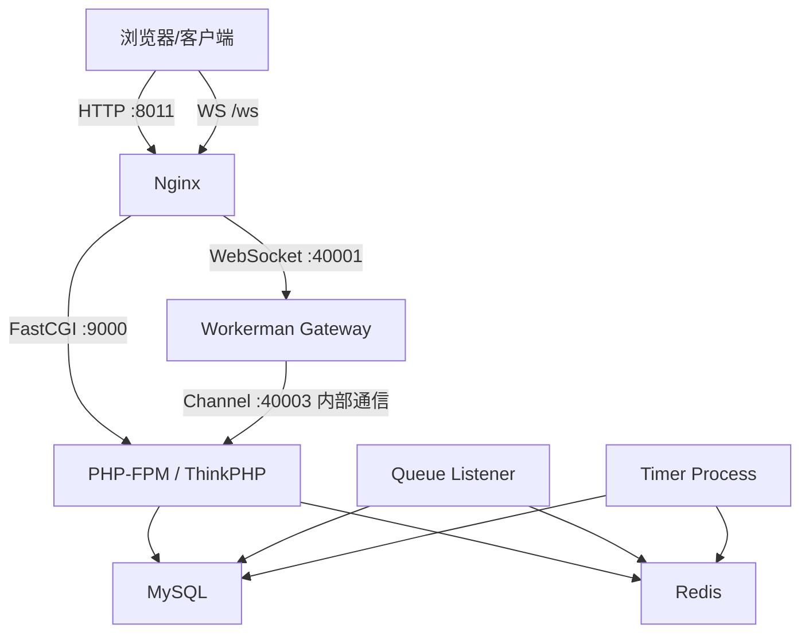
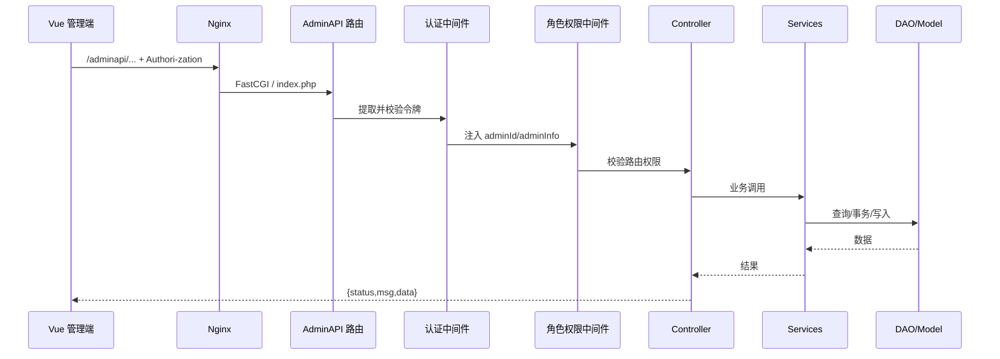
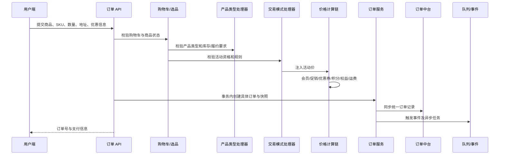
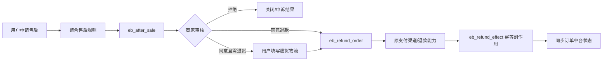
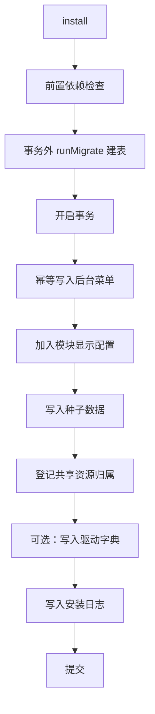

# 项目架构文档

> 核对日期：2026-09-14。本文解释当前实现；强制开发约定以 [AI 开发入口](../../.crmeb/AGENTS.md) 索引的规则为准。

## 1. 架构目标

本项目的架构围绕四个目标展开：

1. 一套后端服务多个终端：管理后台、H5、小程序、App、客服与第三方系统共享核心业务能力。
2. 稳定核心与可变业务分离：通用用户、订单、支付、消息能力放在 `app/`，可选玩法放在 `modules/`。
3. 商品形态与售卖方式解耦：产品类型定义“卖什么”，交易模式定义“怎么卖”。
4. 同步请求与耗时工作分离：HTTP 处理即时业务，队列、定时器和 Workerman 处理异步、周期与实时通信。

## 2. 系统上下文

```mermaid
flowchart LR
    Admin[运营/管理员] --> AdminWeb[Vue 管理端 /admin]
    User[商城用户] --> Uni[H5 / 小程序 / App]
    Kefu[客服人员] --> KefuWeb[客服工作台]
    Third[第三方系统] --> OutAPI[/api/outapi]

    AdminWeb --> AdminAPI[/adminapi]
    Uni --> UserAPI[/api]
    KefuWeb --> KefuAPI[/adminapi/kefu]

    AdminAPI --> Core[ThinkPHP 业务核心]
    UserAPI --> Core
    KefuAPI --> Core
    OutAPI --> Core

    Core --> MySQL[(MySQL 5.7+)]
    Core --> Redis[(Redis)]
    Core --> Queue[队列消费者]
    Core --> WS[Workerman WebSocket]
    Core --> Provider[支付/存储/短信/物流等第三方服务]
```

## 3. 部署拓扑

本地开发默认使用宿主机 PHP、MySQL 和 Redis，具体连接以 `backend/.env` 为准。仓库根目录另提供可选 Docker 编排，包含七个服务并独立托管后台进程：

| 服务 | 容器名 | 容器端口 | 主机端口 | 作用 |
|---|---|---:|---:|---|
| Nginx | `crmeb_nginx` | 80 | 8011 | 静态资源、PHP 转发、WebSocket 反向代理 |
| PHP-FPM | `crmeb_php` | 9000 | 9000 | ThinkPHP HTTP 请求 |
| Timer | `crmeb_timer` | 无公开端口 | 无 | 定时任务 |
| Queue | `crmeb_queue` | 无公开端口 | 无 | Redis 队列消费者与心跳 |
| Workerman 网关 | `crmeb_workerman` | 40001 | 40001 | WebSocket 统一网关与内部 Channel |
| MySQL | `crmeb_mysql` | 3306 | 33061 | 业务数据 |
| Redis | `crmeb_redis` | 6379 | 63791 | 缓存、令牌、锁和队列 |

容器网络使用 `192.168.10.0/24` 的静态地址。Nginx 的 Web 根目录为 `/var/www/public`，对应宿主机 `backend/public`。



生产环境通常还需要：

- TLS 终止与域名配置；
- Supervisor、systemd 或容器编排对队列、定时器、Workerman 的守护；
- MySQL/Redis 的持久化、备份、监控和访问控制；
- 日志采集、告警和容量监控；
- 上传文件使用共享磁盘或对象存储，避免多实例本地文件不一致。

## 4. 代码分层

### 4.1 总体依赖方向

```text
HTTP/CLI 入口
    ↓
Controller / Middleware / Command
    ↓
Services（业务编排、事务、规则）
    ↓
DAO（查询封装）
    ↓
Model（字段、搜索器、关联、类型转换）
    ↓
MySQL / Redis / 第三方驱动
```

跨层基础能力由 `crmeb/` 提供，业务扩展由 `modules/` 注册：

```text
modules/  ───────→ app/ ───────→ crmeb/
   │                 │              │
   │                 └── 使用核心契约┘
   └── 模块之间禁止直接相互依赖，跨模块通过契约或事件通信

crmeb/ ─────────────→ driver/ 的第三方实现
```

### 4.2 `app/`：稳定应用与核心业务

`backend/app` 包含系统长期稳定、跨模块复用的实现：

| 目录 | 职责 |
|---|---|
| `adminapi/` | 管理端应用、控制器、路由、验证器与权限中间件 |
| `api/` | 用户端应用、控制器、路由、验证器与登录中间件 |
| `services/` | 业务规则、业务编排、事务边界、领域服务 |
| `dao/` | 数据查询和持久化操作的封装 |
| `model/` | ThinkPHP 模型、搜索器、关联和属性转换 |
| `jobs/` | 核心异步任务 |
| `listener/` | 核心事件监听器 |
| `command/` | Workerman、Timer、缓存与插件一致性检查命令 |
| `http/middleware/` | CORS、基础初始化和认证公共骨架 |
| `install/upgrade/` | 跨版本数据库升级 SQL 与升级支持代码 |

控制器应保持薄层：读取请求、调用验证器或 Service、返回统一 JSON。复杂查询放 DAO，业务判断和事务放 Services。

### 4.3 `crmeb/`：核心框架与领域契约

`backend/crmeb` 不直接承载具体可选业务模块，主要提供：

- 基础类：Controller、Service、Model、DAO、Jobs、Manager、ModuleInstaller。
- 认证基础设施：令牌提取和令牌校验。
- 插件基础设施：清单读取、依赖解析、发现、安装状态检查、路由加载。
- 驱动管理：支付、上传、短信、邮件、物流、打印等接口和注册机制。
- 领域契约：交易模式、产品类型、订单类型、售后、消息渠道和 WebSocket 服务。
- 通用工具：JSON 响应、缓存、JWT、表单构建、HTTP、二维码、上传等。

关键契约包括：

| 契约/注册中心 | 作用 |
|---|---|
| `TradeModeHandlerInterface` / `TradeModeRegistry` | 注册交易模式处理器 |
| `ProductTypeHandlerInterface` / `ProductTypeRegistry` | 注册产品类型处理器 |
| `OrderTypeAdapterInterface` / `OrderTypeRegistry` | 把不同来源订单适配为统一状态和操作 |
| `AfterSaleHandlerInterface` / `AfterSaleRuleRegistry` | 聚合产品类型和订单类别的售后规则 |
| `OrderCenterSyncInterface` | 具体订单向订单中台同步的反向依赖契约 |
| `ProductQueryInterface` | 核心层访问商品查询能力的契约 |
| `NoticeChannelInterface` / `NoticeMessage` | 渠道适配器契约（渠道类名登记在渠道表 adapter_class，门面按表实例化） |
| `WsServiceHandlerInterface` | 注册统一 WebSocket 网关下的业务服务 |
| `CrontabTaskInterface` / `CrontabTaskRegistry` | 注册模块定时任务 |

### 4.4 `modules/`：业务扩展层

模块按业务域组织：

```text
modules/
├── product/       # 产品类型：实物、网盘、卡密
├── trade/         # 交易模式：砍价、拼团、积分、秒杀
├── marketing/     # 运营玩法：签到、抽奖、新人礼、渠道码、充值
├── channel/       # 渠道：App、H5、微信小程序、微信公众号
├── distribution/  # 分销代理
├── aiagent/       # 后台 AI 对话与自动化任务
├── service/       # 客服、开放平台、独立 MCP 服务
└── system/        # 文件管理等系统扩展
```

标准模块通常包含：

```text
{module}/
├── plugin.json       # 名称、key、类型、版本、依赖与路径
├── App.php           # register/boot 运行时注册入口
├── Installer.php     # 安装、卸载、启用、禁用
├── event.php         # 模块事件监听器表
├── route/            # admin.php / user.php 等场景路由
├── controller/       # admin 与 user/v1 控制器
├── service/ dao/ model/ validate/
├── listener/ jobs/ crontab/
└── handler/          # 产品、交易、订单或售后处理器
```

模块依赖规则：

- 模块可以调用 `app/` 和 `crmeb/` 的公共能力。
- 模块之间不应直接引用具体实现。
- 跨模块协作用事件、注册中心或 `crmeb/` 中的接口。
- 具有清单的模块只有在已安装且启用时才注册处理器和路由。

### 4.5 `driver/`：第三方能力实现

驱动按能力类别组织，每个供应商实现同一类契约：

```text
driver/
├── pay/          # 微信、支付宝、通联等
├── upload/       # 本地、OSS、COS、七牛、OBS 等
├── sms/          # 阿里、腾讯、一号通、云信等
├── email/        # SMTP、QQ、阿里云邮件推送
├── logistics/    # 物流查询
├── express/      # 电子面单
├── printer/      # 云打印
├── invoice/      # 电子发票
├── bot/          # 钉钉、飞书、企业微信机器人
└── copyproduct/  # 商品采集
```

驱动代码可被发现不代表已经启用；运行时仍应以模块安装日志和后台配置为准。

## 5. 多应用与路由架构

ThinkPHP 开启了自动多应用和强制路由：

| 应用/入口 | 路由代码 | URL 形式 |
|---|---|---|
| 管理 API | `app/adminapi/route/*.php` | `/adminapi/...` |
| 用户 API | `app/api/route/*.php` | `/api/...` |
| 模块管理路由 | `modules/**/route/admin.php` | `/adminapi/{模块路由}` |
| 模块用户路由 | `modules/**/route/user.php` | `/api/{模块路由}` |
| 客服路由 | `modules/service/kefu/route/admin.php`、`route/user.php` | 工作台 `/adminapi/kefu/...`，商城用户 `/api/user/service/...` |
| 对外开放路由 | `modules/service/outapi/route/user.php` | `/api/outapi/...` |
| 独立 MCP 路由 | `modules/service/mcp/route/user.php` | `POST /api/mcp` |
| AI Agent 管理路由 | `modules/aiagent/route/admin.php` | `/adminapi/aiagent/...` |
| 页面兜底 | `backend/route/route.php` | 返回管理端或用户端 HTML |

路由加载流程：

1. 多应用根据 URL 第一段选择 `adminapi`、`api` 等应用。
2. 应用主路由文件扫描本应用的业务路由文件。
3. `ModuleRouteLoader` 扫描一、二级模块中的指定场景路由。
4. `ModuleStateChecker` 检查模块安装和启用状态。
5. 禁用模块的路由不加载；miss 路由尽可能返回“插件未安装或未启用”的可读错误。

## 6. HTTP 请求处理链

### 6.1 管理端请求



典型中间件顺序：

1. `AllowOriginMiddleware`：跨域与 OPTIONS。
2. `AdminAuthTokenMiddleware`：认证并注入管理员身份。
3. `AdminCheckRoleMiddleware`：按管理员角色验证路由权限。
4. `AdminLogMiddleware`：记录管理员操作日志。

登录、验证码、升级入口等路由可不经过完整权限链。

客服模块工作台也由管理应用加载，但 `/adminapi/kefu/` 的客服授权组使用 `KefuAuthTokenMiddleware`，不是管理员 token；游客咨询组按路由免登录。客户端 `config.kefu` 只切换 token，不切换到独立 API 应用。

### 6.2 用户端请求

用户端路由有三种认证强度：

| 类型 | 行为 |
|---|---|
| 无认证 | 登录、注册、支付回调、版本等公开服务接口 |
| 可选认证 | 有有效 token 时注入用户；失败时以游客身份继续，`uid=0` |
| 强制认证 | token 无效时返回认证错误，适用于订单、资产和个人数据操作 |

`BlockerMiddleware` 使用 Redis 互斥锁限制同一用户对同一路由的并发提交，常用于下单和售后申请等需要防重复的操作。文件缓存模式下该锁会跳过，因此生产环境应使用 Redis。

### 6.3 令牌提取

所有主要认证端复用统一提取顺序：

1. 配置的自定义头，默认 `Authori-zation`；
2. 标准 `Authorization` 头；
3. GET 参数 `token`；
4. POST 参数 `token`。

头部支持 `Bearer <token>`。参数回退是历史兼容方式，新客户端应使用请求头，避免令牌出现在 URL、日志或监控系统中。

## 7. 商品与订单领域设计

### 7.1 两个正交维度

```text
产品类型（卖什么）              交易模式（怎么卖）
normal   实物                   normal       普通购买
virtual  网盘                   member       会员
cardkey  卡密        ×          seckill      秒杀
                                combination  拼团
                                bargain      砍价
                                integral     积分商城
```

产品类型处理器主要负责：

- 必填字段与商品保存扩展；
- SKU 信息与库存增减；
- 商品详情扩展和选择规格；
- 创建订单扩展数据；
- 支付后履约、取消回滚；
- 是否需要物流、自提和售后能力。

交易模式处理器主要负责：

- 活动价格和营销定价；
- 下单资格、活动时段、数量等校验；
- 下单、支付、退款和完成阶段钩子；
- 活动库存、成团、砍价等生命周期。

### 7.2 下单主链路

具体方法会随订单类型变化，但总体职责如下：



价格扩展约定中，交易模式负责活动单价，固定价格链用于后续优惠计算。代码约定的链路顺序为：会员价、促销、优惠券、积分、权益、运费。新增营销规则时必须明确计算顺序、互斥、分摊和退款口径。

### 7.3 订单中台适配

订单中台通过 `source_type` 定位 `OrderTypeAdapter`，把不同订单表转换为统一模型：

```text
具体订单/扩展订单
    │ source_type
    ▼
OrderTypeRegistry
    ▼
OrderTypeAdapter
    ├── 状态编码与状态树
    ├── 支付状态
    ├── 用户/后台按钮
    ├── 时间轴与进度
    └── 列表/详情扩展
    ▼
统一订单 API / 管理端订单中台
```

新增独立订单类型时必须注册唯一 `source_type`。漏注册会导致订单中台无法解析来源类型。

### 7.4 售后与退款链路

售后和退款是两个关联但不同的概念：

- 售后单描述用户诉求、商品明细、证据、退货物流和处理时间线。
- 退款单描述实际资金退款及其结果。
- 产品类型规则决定可申请的售后类型与期限。
- 退款完成后的库存、佣金、优惠券等副作用需要幂等执行。



## 8. 插件运行时架构

### 8.1 启动注册

`AppService` 启动时完成以下工作：

1. 绑定 JSON 响应服务。
2. 创建交易模式、产品类型、消息渠道等注册中心。
3. 绑定订单中台与商品查询契约的具体实现。
4. 扫描模块清单，提供插件管理元数据。
5. `ModuleRegistry` 扫描模块 `App.php`。
6. 对已安装且启用的模块执行 `register()` 和 `boot()`。
7. 注册核心的普通交易、会员交易。
8. 触发订单类型、消息渠道和 WebSocket 服务注册事件。

### 8.2 安装生命周期

`BaseModuleInstaller` 定义统一生命周期：



DDL 放在事务外，是因为 MySQL 的 DDL 会隐式提交。卸载时先清理业务数据、菜单和共享资源，再执行删表。禁用通常隐藏菜单并停止运行时加载，但保留表与数据；卸载可能删除表和数据，风险更高。

### 8.3 安装状态

运行时有效模块集合来自 `eb_module_install_log`：

```text
status = 1 AND enabled = 1
```

状态表不存在或首次探测异常时，检查器存在兼容放行逻辑。这不是正常启用方式；应检查数据库连接、首次安装结构和生命周期日志，不能依赖异常兜底判断插件可用。

首版新装由安装向导调用 `installRequired()`、`installDefault()`、`installBundledDrivers()`。必需模块受卸载/禁用保护，默认模块和驱动可以按需卸载；完整清单见 [模块说明](模块与驱动.md)。

## 9. 事件架构

核心应用通过 ThinkPHP 事件减少跨业务直接依赖。典型事件包括：

| 事件域 | 示例 |
|---|---|
| HTTP | `HttpEnd` |
| 用户 | `UserLogin`、`UserLogout`、`UserRegister`、余额/积分/经验变化 |
| 管理员 | `AdminLogin` |
| 注册中心 | `OrderTypeRegister`、`WebSocketServiceRegister` |
| 订单 | `OrderCreateAfter`、支付成功、取消、完成等模块事件 |
| 营销 | `OrderPromotionCompute`、新人礼、签到、抽奖等模块监听 |
| 定时器 | `CrontabBeforeRun`、`CrontabAfterRun`、`CrontabSuccess`、`CrontabFail` |

事件使用原则：

- 触发方只知道事件契约，不知道可选模块实现。
- 监听器需要可重入或自行保证幂等，尤其是支付、退款和队列重试场景。
- 关键主流程不能把业务成功完全寄托于无监控的静默监听器。
- 事件参数结构改变属于跨模块契约变化，应同步检查全部监听器。

## 10. 异步任务与定时任务

### 10.1 队列

默认队列连接是 Redis，队列名由 `CRMEB` 与环境中的队列前缀组成。核心异步任务包括：

- 订单、退款、发票、物流和自动收货；
- 海报、商品复制、商品日志和库存；
- 主题导出、翻译和升级；
- 打印、通知、公众号/小程序消息；
- 拼团结果和对外推送。

队列任务必须按“至少执行一次”设计：重复消费不能造成重复扣库存、重复退款、重复发券或重复记账。

### 10.2 定时器

`php think timer start --d` 启动 Workerman 定时进程，从系统定时任务配置和模块注册任务中执行任务。已存在的模块任务包括：

- 未支付订单取消与自动收货；
- 拼团到期处理；
- 分销关系自动解绑；
- 微信小程序直播商品/直播间状态同步；
- 签到提醒。
- 支付记录恢复、退款状态同步与 AI Agent 任务等；具体任务 key 和加载条件以核心与模块注册代码为准。

系统会触发任务开始、结束、成功和失败事件，并可记录定时任务日志。

### 10.3 WebSocket

所有 WebSocket 业务共用端口 `40001`，客户端通过查询参数 `service` 区分业务处理器。当前主要服务是后台消息通知和客服聊天。

Nginx 只维护一个 `/ws` 代理入口；新实时业务应实现 `WsServiceHandlerInterface` 并通过 `WebSocketServiceRegister` 注册，无需新增公网端口。

## 11. 缓存、锁与会话

| 能力 | 实现与注意事项 |
|---|---|
| 通用缓存 | 文件或 Redis；生产建议 Redis |
| 登录令牌状态 | JWT 之外还依赖缓存中的令牌状态，可支持失效控制 |
| 防重复请求 | `BlockerMiddleware` 使用 Redis 互斥锁 |
| 队列 | Redis 独立队列名，需避免多环境串队列 |
| Session | ThinkPHP Session 中间件初始化 |
| 缓存前缀 | 应按环境/项目唯一配置，避免共享 Redis 时键冲突 |

应用扩容前应确认所有需要共享的状态均放在 Redis、MySQL 或对象存储，而不是单机 `runtime` 或本地上传目录。

## 12. 前端架构

### 12.1 管理端

管理端是 Vue 3 + Vue Router 4 + Pinia 2 + Element Plus 2.9 单页应用，使用 Vite 5：

```text
src/
├── api/          # 按业务域封装 AdminAPI
├── pages/        # 页面与模块页面
├── router/       # 静态路由、权限守卫、页面映射
├── store/        # Pinia 实例与 module/ 下的状态模块
├── components/   # 通用组件
├── layouts/      # 管理后台布局
├── libs/         # 请求、启动、Socket 等基础封装
├── diy/          # 页面装修相关能力
├── plugins/      # 前端插件能力
└── setting.js    # API 与路由前缀
```

认证 token 保存在 Cookie，请求拦截器写入 `Authori-zation`。管理菜单由后台返回，前端静态路由提供组件映射。插件页面还支持构建扩展 UMD 包，由页面容器动态加载。

### 12.2 用户端

用户端使用 uni-app：

- 工程根目录是 CLI 与构建配置，业务源码位于 `frontend/uni-app/src/`，使用 Vue 3、Pinia 和 Vite 5。
- 主包包含引导、首页、购物车、个人中心和分类。
- 分包覆盖商品详情、订单、支付、售后、文章、营销、分销、会员、积分等功能。
- `utils/request.js` 统一拼接 `/api/`、添加 token、渠道和语言头，并处理登录过期/站点维护状态。
- 不同平台通过 `#ifdef` 条件编译，业务改动必须至少检查 H5 与目标小程序/App 编译分支。

## 13. 数据架构

首版新装的数据结构主要来自基础 SQL 和插件 Installer：

1. `backend/public/install/crmeb_table.sql`：新安装基础表，本次静态核对包含 127 个建表语句。
2. 各模块 `Installer.php::runMigrate()`：插件安装时创建扩展表并处理自有结构。

新增表/字段必须同时考虑：

- 全新安装；
- 首版改动直接更新首次安装定义，不新增版本号或旧站点升级链；若未来明确维护存量站点，再评估增量迁移；
- 模块首次安装；
- 模块重复安装、禁用、启用和卸载；
- 多表前缀配置。

详见[数据库设计](数据库设计.md)。

## 14. 可靠性设计要点

- 订单、库存、资产和退款写入应明确事务边界。
- 支付回调、退款回调、队列任务和定时任务必须幂等。
- 商品和订单采用快照，避免历史订单受当前商品配置变化影响。
- 外部服务调用要设置超时、记录业务标识，并支持失败重试或人工补偿。
- 队列失败任务应可查询、重放且不破坏业务一致性。
- 模块禁用要确保路由、事件和处理器同时停止加载，避免半启用状态。
- WebSocket 仅承担实时通知，不应成为订单等核心状态的唯一存储。

## 15. 架构约束与风险

| 项目 | 当前约束/风险 | 建议 |
|---|---|---|
| 自动化测试 | 已有后端与前端专项回归脚本，缺少统一的完整端到端覆盖 | 按改动运行相关脚本，继续补充订单、Installer 和权限覆盖 |
| 产品/交易兼容 | 兼容声明未完全运行时强制 | 在后台选品和下单入口统一校验 |
| 路由规模 | 核心与模块路由数量较多 | 保持分域文件，新增路由写 `real_name` 和权限规则 |
| 历史兼容 | API 存在 v1/v2 和旧参数/表兼容 | 新增接口优先复用中台，记录弃用计划 |
| 本地状态 | `runtime`、本地上传和进程 PID 为单机状态 | 多实例使用 Redis、对象存储和集中式进程管理 |
| 插件 DDL | MySQL DDL 不能可靠事务回滚 | Installer 保持幂等，失败后提供明确修复步骤 |
| 配置安全 | 部分配置文件/前端清单可能含敏感 SDK 配置 | 全面环境化、轮换并禁止提交真实密钥 |

## 16. 新能力的归属判断

新增需求可按以下顺序判断放置位置：

1. 决定商品形态、SKU、库存、履约或售后规则：放 `modules/product/{type}`。
2. 改变商品定价、下单资格或订单交易生命周期：放 `modules/trade/{mode}`。
3. 只监听业务事件并发奖励，不改变成交：放 `modules/marketing/{name}`。
4. 解决用户从哪里来、如何登录或推送：放 `modules/channel/{channel}`。
5. 对接同类第三方供应商：放 `driver/{category}/{provider}`。
6. 跨多个模块稳定复用的业务能力：放 `app/services`，必要时在 `crmeb/` 定义接口。
7. 通用框架基础设施或领域契约：放 `crmeb/`，不得反向依赖具体模块。
